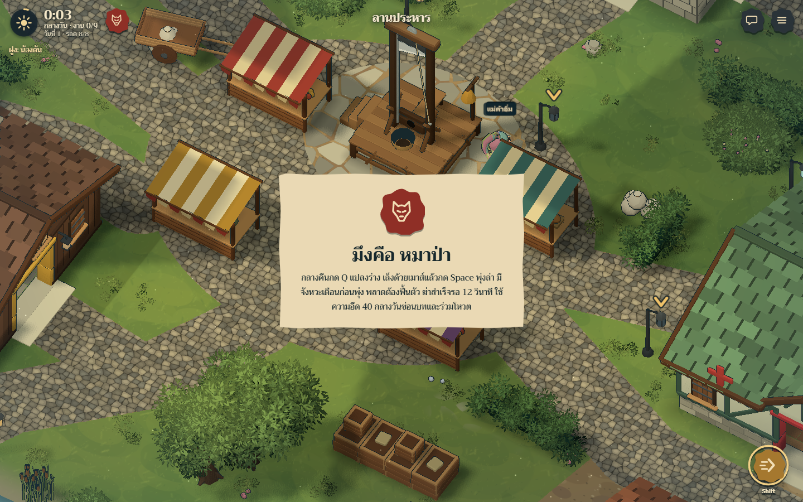
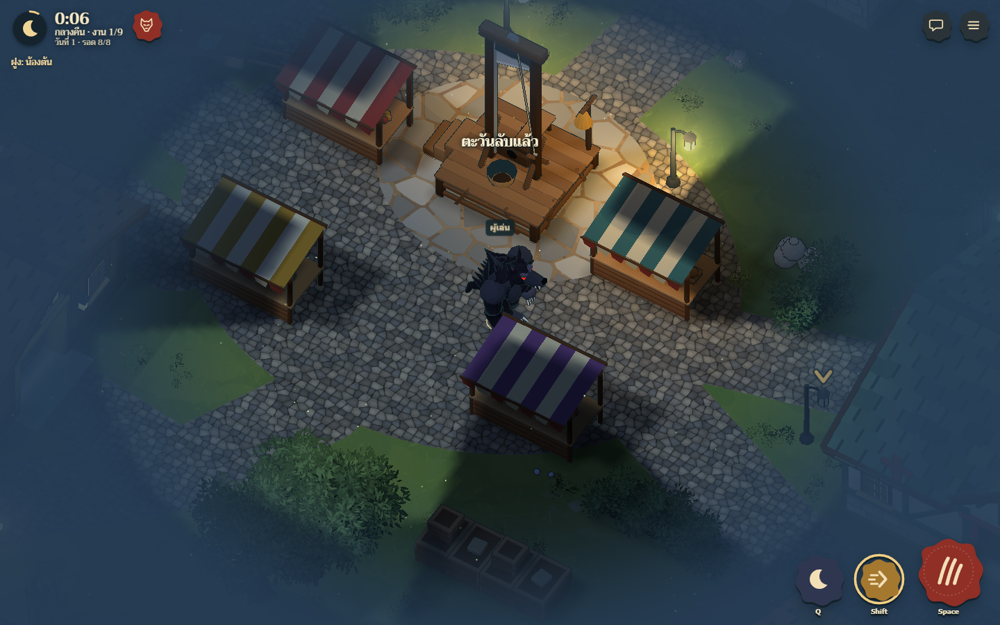

# Moonfall

### [▶ เล่นเลย / Play in your browser](https://sacmaib80-cmyk.github.io/moonfall/)

เกมหมาป่าในหมู่บ้านโรงสี กลางวันเดินช่วยงานและจับผิดกัน กลางคืนหมาป่าแปลงร่างออกล่า แล้วทุกคนโหวตว่าใครต้องขึ้นกิโยติน

หน้านี้เล่นคนเดียวกับบอท เลือกบทได้ก่อนเริ่ม เกมยังเป็นต้นแบบ และยังไม่ได้ลองบนมือถือจริง

| ปุ่ม | การกระทำ |
|---|---|
| WASD | เดิน |
| เมาส์ | เล็งพุ่งล่า |
| Shift | ฮึดหลบ |
| Q | หมาป่าแปลงร่าง |
| Space | ใช้สกิล |
| E | เปิดปิดประตูและหน้าต่าง / กดค้างช่วยงาน |

A werewolf game in Thai. The link above runs entirely in the browser, against bots.

ฉากและตัวละครทั้งหมดสร้างด้วยโค้ดของโปรเจกต์นี้ ไลบรารีกับฟอนต์ที่ใช้อยู่ใน [THIRD-PARTY-NOTICES.md](THIRD-PARTY-NOTICES.md)
