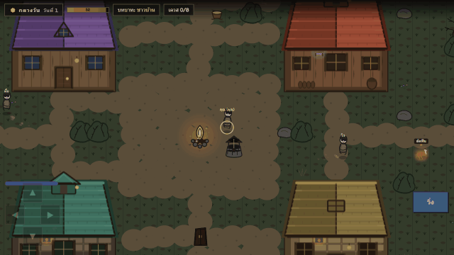

# Moonfall

**A social-deduction game where the bots lie, hunt, and vote against you.**

A top-down village where some players are wolves. You do tasks in daylight, wolves kill at night,
and everyone argues and votes. Played against AI opponents rather than a lobby of humans.

## What's interesting in here

- **Bots that play the social game, not just the movement game.** Each bot keeps a suspicion score
  per villager and updates it from things it actually observed: who it saw completing a task, who
  was standing next to a fresh body, who it has line of sight on. Wolves avoid witnesses, leave the
  area after a kill, and coordinate their votes.
- **A\* pathfinding**, so bots route around buildings instead of walking into walls.
- **A 3.5x frame-rate fix found by measuring, not guessing.** The game ran at 17fps; profiling showed
  the cost wasn't game logic but re-rasterizing vector art every single frame. Converting the art to
  bitmaps once at load time took it to a stable 60fps.
- **Houses generated as vector art from code**, with roofs that fade out when a character walks
  inside so you can see the room.
- Balance tuned against a headless simulation of complete matches, not by feel.

## Stack

Vanilla JavaScript · Canvas 2D · code-generated SVG · no dependencies

## Honest notes

Single-player against bots. The multiplayer version is a separate project (Pixel Clash) — the
networking here is not built yet.
